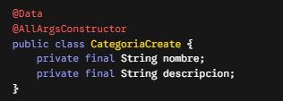
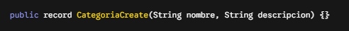

# 1. El Problema Histórico: Spring Clásico
Levantar un proyecto implicaba lidiar con archivos XML gigantescos, resolver conflictos de versiones de dependencias manualmente y configurar servidores externos como Tomcat por separado.

**`La solucion: SpringBoot`**
Spring Boot es igual a Spring Framework más configuración automática y convenciones inteligentes. Elimina la configuración repetitiva para que puedas enfocarte directamente en tu lógica de negocio, esta agilidad se logra gracias a:

1. **Starters:** Son dependencias preconfiguradas que incluyen todas las librerías necesarias para una funcionalidad específica, asegurando que las versiones sean 100% compatibles entre sí.
2. **Autoconfiguración**: Es el "cerebro" detrás de la magia. Spring Boot examina automáticamente para detectar qué dependencias (starters) tienes instaladas y aplica configuraciones inteligentes por defecto. Por ejemplo, si detecta spring-boot-starter-web, automáticamente te levanta un servidor Tomcat embebido y te configura Spring MVC.

**`JPA Puro y SpringBoot`**
En JPA Puro hay que armar el archivo META-INF/persistence.xml, definir las credenciales de la base de datos, los dialectos, instanciar a mano el EntityManagerFactory y gestionar el inicio y cierre de transacciones en cada método.

# 2.Estructura Base y el Corazón de Spring Boot

Al generar tu proyecto, Spring Initializr te entrega una estructura estándar de Maven:

- **`src/main/java`**: Aquí va todo tu código fuente Java (tus entidades, DTOs, repositorios, etc.).
- **`src/main/resources`**: Contiene archivos de configuración, recursos estáticos y plantillas. Aquí reside `application.properties`, donde más configuramos la conexión a H2.
- **`pom.xml`**: El archivo que gestiona las dependencias de Maven.

Dentro de `src/main/java`, tienes tu clase principal (en este caso,`TpSpringBootApplication.java`). Esta clase está decorada con la anotación **`@SpringBootApplication`**, la cual es el corazón de la aplicación porque agrupa tres anotaciones vitales en una sola:

1. **`@Configuration`**: Le dice a Spring que esta clase puede definir beans de configuración.
2. **`@EnableAutoConfiguration`**: Configura componentes automáticamente según el classpath.
3. **`@ComponentScan`**: Le indica a Spring que escanee el paquete actual (y sus subpaquet  es) en busca de componentes para gestionarlos.

Al ejecutar esta clase desde tu IDE, Spring Boot levanta un servidor Tomcat embebido y tu aplicación queda disponible, por defecto, en el puerto 8080.(.**`\mvnw.cmd spring-boot:run`**)

 # 3. El Núcleo - ApplicationContext y Beans.
 El ApplicationContext es el contenedor principal y el corazón de Spring Boot. Funciona como un administrador central que se encarga de crear, organizar y conectar todos los componentes de tu aplicación.  
**`Los Beans`**
 Son, sencillamente, los **objetos** que viven dentro de ese ApplicationContext. En lugar de que tú instancies objetos manualmente usando la palabra reservada new (por ejemplo, new PedidoService()), le delegas esa tarea a Spring. 
 Spring crea el objeto, administra su ciclo de vida completo y lo reutiliza en toda la aplicación, evitando desperdiciar memoria con instancias duplicadas.
 
**`Ciclo de vida de un Bean`**
Sigue estos pasos ordenados:   
1. **`Detección`**: Spring encuentra la clase mediante el "Component scan".  
2. **`Instanciación`**: Se crea el objeto usando su constructor.   
3. **`Inyección`**: Spring inyecta las dependencias que ese objeto necesita. 
4. **`Inicialización, Uso y Destrucción:`**. Para que el Component Scan (el detective automático de Spring) detecte tus clases y las convierta en Beans, debes marcarlas con anotaciones especiales. 

En el Trabajo Práctico, estas anotaciones se conocen como estereotipos (@Service, @Repository, @Component) y sirven para definir el rol de cada clase en la arquitectura.
Cada **estereotipo** deben verse como etiquetas que definen el rol exacto de la clase en tu arquitectura:
1. **`@Component`**:Es la anotación más genérica. Se utiliza para marcar clases utilitarias o componentes generales que quieres que Spring administre
2. **`@Service`**: Se aplica a las clases donde reside la **lógica de negocio**
3. **`@Repository`**:Se utiliza estrictamente para las clases e interfaces que manejan el **acceso a los datos**, como un UsuarioRepository que interactúa con la base de datos. Spring le añade un comportamiento extra a este estereotipo: captura las excepciones nativas de la base de datos y las traduce a un formato estándar más fácil de manejar.
4. **`@Controller`**:Se asigna a las clases que actúan como puntos de entrada, **manejando peticiones HTTP**

### Ejemplo de `@Service` e inyección por constructor

**`Entidades Records `**
Un **record** es una estructura nativa de Java diseñada específicamente para crear clases que solo transportan datos y que son inmutables (una vez creadas, sus datos no cambian).
### Ejemplo de `@Record` forma clasica 

### Ejemplo de `@Record`forma moderna 

Con esa simple línea del record, Java genera automáticamente por detrás el constructor, el equals(), el hashCode(), el toString() y los métodos para leer los datos. Son ideales para los DTOs porque los DTOs no necesitan lógica, solo trasladar información de un lado a otro. 

